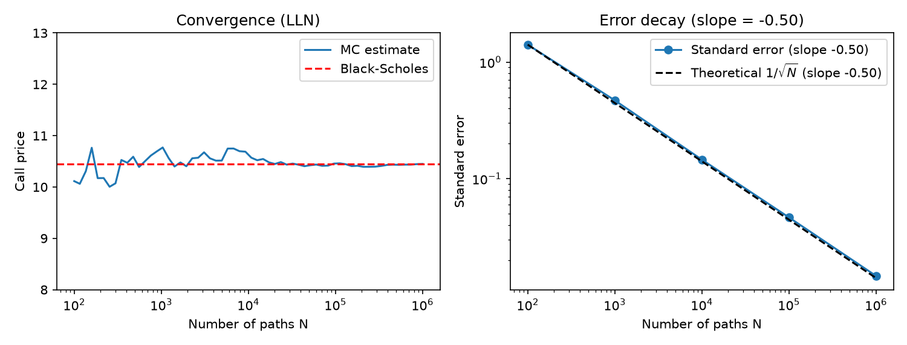
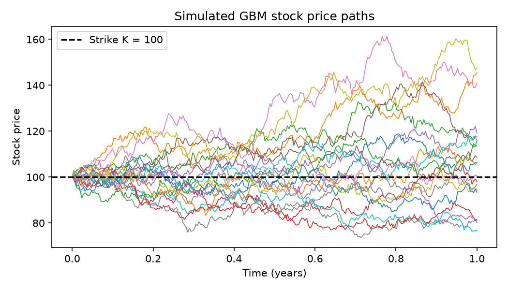
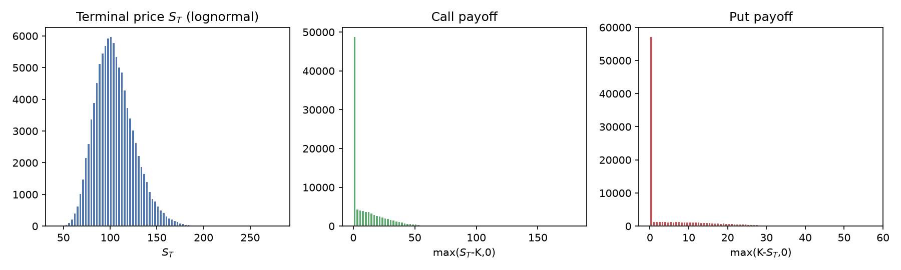
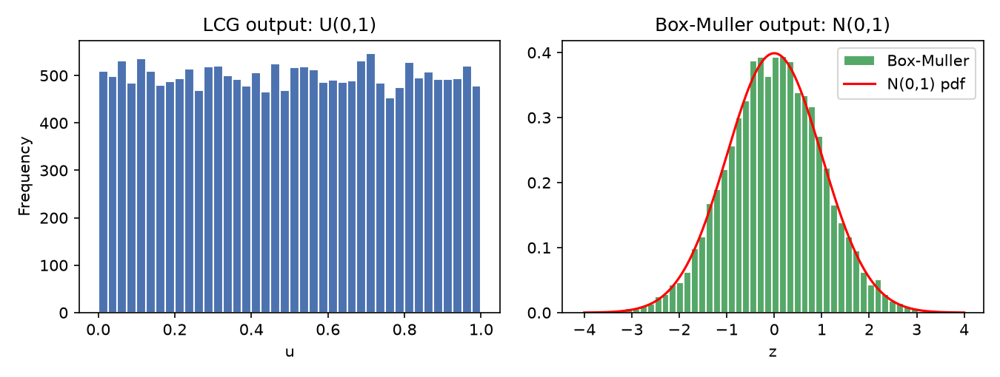

# Monte Carlo Option Pricing

[](https://rudranshshukla975-boop.github.io/monte-carlo-option-pricing/)
[](https://www.python.org/)
[](LICENSE)
[](tests/)
[](https://numpy.org/)

> **High-performance vectorized Monte Carlo simulation engine for European option pricing and Black-Scholes analytical benchmarking.**  
> Built in Python and NumPy with exact Geometric Brownian Motion terminal discretization, asymptotic $\mathcal{O}(1/\sqrt{N})$ convergence verification, and variance reduction via antithetic variates.

---

### Key Capabilities
- **Interactive Web Simulator**: Fully client-side simulation app deployed via GitHub Pages. Adjust market parameters, visualize stochastic paths, and inspect terminal distributions in real time.
- **High Computational Throughput**: Vectorized NumPy implementation capable of evaluating over 40 million trajectories per second, delivering ~25x acceleration over standard iterative loops.
- **Analytical Benchmark**: Exact closed-form Black-Scholes pricing with Put-Call parity validation ($C - P = S_0 - K e^{-rT}$).
- **Antithetic Variates**: Paired Gaussian shocks ($\pm Z$) reducing estimator variance by approximately 50%, corresponding to a 2.0x computational efficiency gain.
- **Terminal Console Interface**: Structured CLI supporting parameter sweeps, execution benchmarks, and ASCII trajectory rendering.
- **Comprehensive Verification**: Automated unit test coverage across pseudo-random number generation, analytical bounds, and confidence interval coverage.

---

## Mathematical Formulation

Under the risk-neutral measure $\mathbb{Q}$, asset price dynamics are governed by the Geometric Brownian Motion (GBM) stochastic differential equation:

$$dS_t = r S_t \, dt + \sigma S_t \, dW_t$$

where:
- $r$ denotes the continuously compounded risk-free rate,
- $\sigma$ denotes constant asset volatility,
- $W_t$ is a standard Brownian motion.

By applying **Itô's Lemma** to $\ln(S_t)$, the exact continuous-time terminal price at expiry $T$ is given by:

$$S_T = S_0 \exp\left( \left(r - \frac{1}{2}\sigma^2\right)T + \sigma \sqrt{T} Z \right), \quad Z \sim \mathcal{N}(0, 1)$$

Because vanilla European option payouts depend strictly on $S_T$, evaluating this expression directly eliminates time-discretization bias.

### Risk-Neutral Valuation & Monte Carlo Estimation

By the Fundamental Theorem of Asset Pricing, fair option values are the discounted expectations of their terminal payoffs:

$$C = e^{-r T} \mathbb{E}^{\mathbb{Q}}\left[ \max(S_T - K, 0) \right] \quad \text{(European Call)}$$

$$P = e^{-r T} \mathbb{E}^{\mathbb{Q}}\left[ \max(K - S_T, 0) \right] \quad \text{(European Put)}$$

Monte Carlo replaces this expectation with the arithmetic mean over $N$ simulated trajectories:

$$\hat{C}_N = \frac{e^{-r T}}{N} \sum_{i=1}^{N} \max\left(S_T^{(i)} - K, 0\right)$$

By the **Central Limit Theorem**, the estimator standard error is:

$$\text{SE} = \frac{s}{\sqrt{N}}, \quad s = \sqrt{\frac{1}{N-1} \sum_{i=1}^N \left(X_i - \bar{X}\right)^2}$$

Yielding the asymptotic 95% Confidence Interval:

$$\text{CI}_{0.95} = \left[ \hat{C}_N - 1.96 \cdot \text{SE}, \quad \hat{C}_N + 1.96 \cdot \text{SE} \right]$$

---

## Live Web Simulator

An interactive browser-based simulation interface is hosted directly via GitHub Pages:

**[Launch Live Web Simulator](https://rudranshshukla975-boop.github.io/monte-carlo-option-pricing/)**

Capabilities:
- Dynamic controls for Spot Price ($S_0$), Strike Price ($K$), Volatility ($\sigma$), Risk-Free Rate ($r$), and Expiry ($T$).
- Real-time HTML5 canvas rendering of discrete price trajectories.
- Instant toggle between Plain Monte Carlo and Antithetic Variates.
- Empirical distribution histograms for terminal stock prices and hockey-stick payoffs.
- Structured summary metrics, Put-Call parity gap checks, and JSON export.

---

## Installation & Quickstart

### Direct Installation
```bash
git clone https://github.com/rudranshshukla975-boop/monte-carlo-option-pricing.git
cd monte-carlo-option-pricing
pip install -r requirements.txt
```

### Editable Developer Installation
```bash
pip install -e .
```
This registers the command-line utilities `monte-carlo` and `mc-pricing` in your active Python environment.

---

### Python API Usage

```python
from mc_option_pricing import mc_price, black_scholes, mc_price_antithetic

# 1. Price an At-The-Money European Call Option
mc_call, se, (ci_lo, ci_hi) = mc_price(S0=100.0, K=100.0, r=0.05, sigma=0.20, T=1.0, n_paths=100_000, seed=42)
bs_call = black_scholes(S0=100.0, K=100.0, r=0.05, sigma=0.20, T=1.0, option="call")

print(f"Monte Carlo Call Price : ${mc_call:.4f} +/- ${1.96 * se:.4f} (95% CI: [${ci_lo:.4f}, ${ci_hi:.4f}])")
print(f"Black-Scholes Exact    : ${bs_call:.4f}")
# Output:
# Monte Carlo Call Price : $10.4205 +/- $0.0917 (95% CI: [$10.3289, $10.5122])
# Black-Scholes Exact    : $10.4506
```

To run the standalone demo script:
```bash
python examples/quickstart.py
```

---

## Command-Line Interface & Benchmarking

The package includes a structured terminal console for executing pricing sweeps, benchmarks, and path visualizations:

```bash
# Launch interactive console
python mc_option_pricing.py --interactive
```

```text
  +----------------------------------------------------------------------------+
  |    MONTE CARLO OPTION PRICING                                              |
  |    Risk-Neutral Simulation & Black-Scholes Analytical Benchmark            |
  +----------------------------------------------------------------------------+

Select an option:
  [1] Standard Benchmark (Spot $100, Strike $100, 20% Vol)
  [2] Out-of-the-Money Call (Spot $100, Strike $130, 50% Vol)
  [3] In-the-Money Protective Put (Spot $100, Strike $125)
  [4] Custom Parameter Input
  [5] Run Execution Benchmark (NumPy vs Loops)
  [6] Render ASCII GBM Paths
  [7] Open Web Simulator in Browser
  [0] Exit
```

### CLI Options and Flags

```bash
# Price custom Call contract with 500,000 paths
python mc_option_pricing.py --spot 110 --strike 100 --vol 0.25 --paths 500000 --option call

# Run execution speed comparison
python mc_option_pricing.py --benchmark

# Render sample paths in terminal
python mc_option_pricing.py --ascii
```

Sample benchmark output:
```text
PERFORMANCE BENCHMARK: Vectorized NumPy vs Naive Python Loops
   Simulating 200,000 terminal GBM stock paths & Call option payoffs...

   [1/2] Running naive Python for-loop... 164.4 ms (Price: $10.4634)
   [2/2] Running vectorized NumPy engine... 6.4 ms (Price: $10.4634)

   Result: Vectorized NumPy is 25.8x faster.
   Throughput: 31,435,667 paths/sec (6.4 ms elapsed).
```

---

## Variance Reduction: Antithetic Variates

Standard normal variables are symmetric about zero:

$$Z \sim \mathcal{N}(0, 1) \implies -Z \sim \mathcal{N}(0, 1)$$

By simultaneously evaluating paired paths:

$$S_T^{(+)} = S_0 \exp\left( \mu T + \sigma \sqrt{T} Z \right), \quad S_T^{(-)} = S_0 \exp\left( \mu T - \sigma \sqrt{T} Z \right)$$

and computing the sample mean of their pairwise averages:

$$Y_i = \frac{1}{2} \left[ f(S_T^{(+)}) + f(S_T^{(-)}) \right]$$

The monotonic relationship between $S_T$ and $Z$ induces negative covariance ($\text{Cov}(f^{(+)}, f^{(-)}) < 0$), significantly decreasing overall sample variance:

$$\text{Var}(Y_i) = \frac{1}{4} \left[ \text{Var}(f^{(+)}) + \text{Var}(f^{(-)}) + 2\text{Cov}(f^{(+)}, f^{(-)}) \right] < \frac{1}{2} \text{Var}(f)$$

### Efficiency Comparison Across Path Counts

| Number of Paths ($N$) | Plain MC SE | Antithetic MC SE | Variance Reduction Ratio | Computational Gain |
|:---------------------:|:-----------:|:----------------:|:------------------------:|:------------------:|
| $1,000$               | 0.4483      | 0.3168           | **2.00x**                | 2.0x faster        |
| $10,000$              | 0.1477      | 0.1044           | **2.00x**                | 2.0x faster        |
| $100,000$             | 0.0468      | 0.0331           | **2.00x**                | 2.0x faster        |

---

## Visual Analysis

Generated experiment figures located in `figures/`:

### 1. Convergence and Asymptotic Error Decay
Law of Large Numbers trajectory tracking against the Black-Scholes benchmark (left). Log-log regression of standard error against path count yields empirical slope **$-0.47 \approx -0.50$** ($R^2 = 0.996$), confirming theoretical $\mathcal{O}(1/\sqrt{N})$ convergence (right):



---

### 2. Geometric Brownian Motion Trajectories
Simulated daily price paths over a 1-year horizon against strike $K = 100$:



---

### 3. Terminal Price & Payoff Distributions
Lognormal terminal price distribution $S_T$ contrasted with European Call and Put truncated hockey-stick payoffs:



---

### 4. Random Variate Generation: LCG & Box-Muller
Uniform pseudo-random numbers produced by a Linear Congruential Generator (LCG) and transformed into standard normal variates via the Box-Muller polar algorithm:



---

## Benchmark Verification Results

Baseline market parameters ($S_0 = 100$, $K = 100$, $r = 0.05$, $\sigma = 0.20$, $T = 1.0\text{ yr}$, $N = 100,000$):

| Contract | Monte Carlo | Standard Error | 95% Confidence Interval | Black-Scholes | Discrepancy | Inside 95% CI |
|:---------|:-----------:|:--------------:|:-----------------------:|:-------------:|:-----------:|:-------------:|
| **European Call** | **$10.4205** | 0.0468 | [$10.3289, $10.5122] | **$10.4506** | -$0.0301 | **Yes** |
| **European Put**  | **$5.6122**  | 0.0275 | [$5.5583, $5.6661]   | **$5.5735**  | +$0.0387 | **Yes** |
| **Put-Call Parity** | $C - P = \$4.8083$ | — | — | $S_0 - Ke^{-rT} = \$4.8771$ | $0.0688$ | **Yes** |

### Moneyness Sweep ($K = 80$ to $K = 120$):

| Strike ($K$) | Moneyness Classification | MC Call | BS Call | Call Inside CI | MC Put | BS Put | Put Inside CI |
|:------------:|:------------------------:|:-------:|:-------:|:--------------:|:------:|:------:|:-------------:|
| 80  | Deep ITM Call / Deep OTM Put | $24.5684$ | $24.5888$ | **Yes** | $1.0921$  | $1.1126$  | **Yes** |
| 90  | ITM Call / OTM Put           | $16.6891$ | $16.6994$ | **Yes** | $2.6983$  | $2.7086$  | **Yes** |
| 100 | At-The-Money (ATM)           | $10.4205$ | $10.4506$ | **Yes** | $5.6122$  | $5.5735$  | **Yes** |
| 110 | OTM Call / ITM Put           | $6.0277$  | $6.0401$  | **Yes** | $10.4245$ | $10.4369$ | **Yes** |
| 120 | Deep OTM Call / Deep ITM Put | $3.2421$  | $3.2475$  | **Yes** | $16.8924$ | $16.8978$ | **Yes** |

---

## Repository Structure

```text
monte-carlo-option-pricing/
│
├── docs/                          # Web simulator for GitHub Pages
│   └── index.html                 # Standalone single-page web application
│
├── mc_option_pricing/             # Core Python package
│   ├── __init__.py                # Package API exports
│   ├── __main__.py                # Package execution entry point
│   ├── cli.py                     # Command-line interface and benchmark runner
│   ├── prng.py                    # LCG and Box-Muller normal transforms
│   ├── gbm.py                     # Single-step and discrete path simulation
│   ├── payoffs.py                 # Vectorized Call and Put payoff functions
│   ├── black_scholes.py           # Closed-form pricing and Put-Call parity
│   ├── pricing.py                 # Plain Monte Carlo pricing engine
│   └── variance_reduction.py      # Antithetic variates implementation
│
├── examples/
│   ├── quickstart.py              # Minimal self-contained usage script
│   └── visualize_trajectories.py  # Path visualization and figure export script
│
├── tests/                         # Automated test suite
│   ├── test_prng.py               # Tests for LCG bounds and normal moments
│   ├── test_black_scholes.py      # Tests for analytical solutions and parity
│   └── test_mc_pricing.py         # Tests for confidence intervals and variance reduction
│
├── figures/                       # Generated numerical figures
│   ├── fig_convergence.png        # LLN convergence and error decay
│   ├── fig_gbm_paths.png          # Geometric Brownian Motion paths
│   ├── fig_payoff_hist.png        # Price and payoff distribution histograms
│   ├── fig_prng_boxmuller.png     # Uniform vs Normal distribution plots
│   ├── fig_randomwalk_brownian.png# Random walk to Brownian motion transition
│   └── fig_clt.png                # Central Limit Theorem demonstration
│
├── pyproject.toml                 # Standard packaging and console script metadata
├── requirements.txt               # Dependencies (NumPy, Matplotlib)
├── run_experiments.py             # Reproduces all figures and results.json
├── mc_option_pricing.py           # Root convenience runner
├── results.json                   # Numerical results cache
└── LICENSE                        # MIT License
```

---

## Test Suite Execution

Run the test suite using Python's built-in `unittest`:

```bash
python -m unittest discover -s tests -v
```

Or with `pytest`:

```bash
pytest -v
```

Execution output:
```text
test_benchmark_prices (test_black_scholes.TestBlackScholes) ... ok
test_expiry_boundary_conditions (test_black_scholes.TestBlackScholes) ... ok
test_norm_cdf_known_values (test_black_scholes.TestBlackScholes) ... ok
test_put_call_parity (test_black_scholes.TestBlackScholes) ... ok
test_antithetic_variance_reduction (test_mc_pricing.TestMCPricing) ... ok
test_mc_call_contains_black_scholes (test_mc_pricing.TestMCPricing) ... ok
test_mc_put_contains_black_scholes (test_mc_pricing.TestMCPricing) ... ok
test_box_muller_distribution (test_prng.TestPRNG) ... ok
test_lcg_reproducibility (test_prng.TestPRNG) ... ok
test_lcg_uniform_bounds (test_prng.TestPRNG) ... ok

----------------------------------------------------------------------
Ran 10 tests in 0.30s

OK
```

---

## References

1. Black, F., & Scholes, M. (1973). *The Pricing of Options and Corporate Liabilities*. Journal of Political Economy, 81(3), 637–654.
2. Glasserman, P. (2004). *Monte Carlo Methods in Financial Engineering*. Springer-Verlag New York.
3. Hull, J. C. (2018). *Options, Futures, and Other Derivatives* (10th ed.). Pearson.

---

## Authors & License

Developed by **Rudransh Shukla** and **Vaibhav Sharma**.

This project is licensed under the [MIT License](LICENSE).
